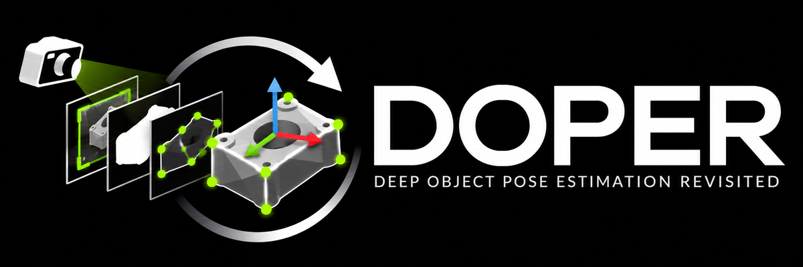

<p align="center">
  
</p>

Hugo Hadfield, Alperen Degirmenci, Jonathan Tremblay

🌐 [Website](https://nvlabs.github.io/DOPER/) · 📄 Paper (coming soon)

DOPER trains and evaluates keypoint-based 6-DoF object pose models from synthetic data: it
renders COCO-style training splits from a CAD model with Blender, trains a DINOv3 ConvNeXt
detector with a heatmap keypoint head, recovers poses from the keypoints, and reproduces the paper's
BOP evaluations (HANDAL, HOPE v2, HOT3D, T-LESS). It also prepares SPEED+ data, evaluates a
SPEED+ checkpoint on SHIRT, and adapts a model to a real object from NuRec renders. The `doper`
command drives the packaged recipes; the rendering and training entry points also work on your
own CAD files.

## Install

Python 3.11 or newer and [uv](https://docs.astral.sh/uv/) are required; rendering needs Blender
4.2 LTS or newer (`blender` on `PATH`, or `export DOPER_BLENDER=/path/to/blender`).

From a checkout of this repository:

```bash
uv sync
source .venv/bin/activate
```

Optional features are extras (`uv sync --extra bop`; several at once with repeated `--extra`):

| Extra | Adds |
| --- | --- |
| `bop` | Hugging Face downloads and CAD I/O for the BOP recipes |
| `isaac` | no packages: Isaac Sim 6.0.1 is a container image (`nvcr.io/nvidia/isaac-sim:6.0.1`), not a wheel |
| `usd` | USD scene handling (`usd-core`) |
| `keypoints` | numba-accelerated keypoint selection |
| `refine` | numba L-BFGS-B heatmap refinement and parallel preparation |
| `tensorrt` | ONNX export for TensorRT (TensorRT itself comes from the platform) |
| `realsense` | no packages: `pyrealsense2` comes from the platform |
| `filter` | the Kalman filters of the SHIRT evaluation (`bayesfilter`) |
| `hdf5` | HDF5 episode reading for pseudo-labels (`h5py`) |
| `speedplus` | the SPEED+ tracked-landmark extractor |
| `nurec-sam` | SAM2 masks of the NuRec labels stage |

### Pretrained weights

This release contains code only. Trained DOPER checkpoints are not included; they are planned
for a separate release.

Building a model with `pretrained: true`, the default, downloads the pretrained backbone on
your machine:
- The default `convnext_small.dinov3_lvd1689m` and the other DINOv3 ConvNeXt backbones come
  from Hugging Face through `timm`. They are Meta's DINOv3 weights, under the
  [DINOv3 License](https://github.com/facebookresearch/dinov3/blob/main/LICENSE.md), which has
  its own use restrictions.
- The optional ResNet backbones use the default torchvision weights.

DOPER does not redistribute either. Downloading and using them is subject to their own terms,
and models you train from them may be too.

NOTICE AND DISCLAIMER: This software automatically retrieves, accesses or interacts with external
materials. Those retrieved materials are not distributed with this software and are governed
solely by separate terms, conditions and licenses. You are solely responsible for finding,
reviewing and complying with all applicable terms, conditions, and licenses, and for verifying the
security, integrity and suitability of any retrieved materials for your specific use case. This
software is provided "AS IS", without warranty of any kind. The author makes no representations or
warranties regarding any retrieved materials, and assumes no liability for any losses, damages,
liabilities or legal consequences from your use or inability to use this software or any retrieved
materials. Use this software and the retrieved materials at your own risk.

## Quickstart

[examples/minimal/README.md](examples/minimal/README.md) takes a bundled CAD model through
keypoint selection, rendering a train and a validation split, loading them with
`doper.dataset.DoperDataset`, a training dry run and a short CPU smoke train. Use it first to
check that Blender and the install work, then follow [Rendering synthetic data](#rendering-synthetic-data)
for your own CAD file.

## Recipes

The BOP, SPEED+ and SHIRT recipes follow the paper. The NuRec workflow takes a recipe for your own
capture instead (see [NuRec adaptation](#nurec-adaptation)).

Every `doper` verb takes `--dry-run`, which prints the ordered steps with their inputs and
outputs and touches no data: run it first. `--root` is the dataset root and `--runs` the output
directory; both are always explicit.

| Recipe | `doper` verbs | Not scripted by `doper` |
| --- | --- | --- |
| `handal`, `hopev2`, `hot3d`, `tless` | `prepare`, `train`, `review`, `evaluate`, `report` | none |
| `speedplus` | `prepare` (`--stage fetch`, `convert`, `extract-landmarks`, `layout`) | training a SPEED+ model, and evaluating it on SPEED+ itself |
| `shirt` | `evaluate` (`--method framewise`, `candidates`, `pnp-ukf`, `pnp-ukf-rts`, `keypoint-ukf`) | obtaining the SHIRT data, and training the SPEED+ checkpoint it evaluates |

```bash
doper prepare handal --root data/bop --dry-run
doper train handal --stage base --root data/bop --runs runs --obj-id 1 --dry-run
doper evaluate handal --split val --root data/bop --runs runs --dry-run
doper report handal --runs runs --dry-run
doper prepare speedplus --stage fetch --root data/speedplus --accept-license --dry-run
doper evaluate shirt --method framewise --root data/shirt --runs runs \
  --checkpoint speedplus.pth --keypoints-3d keypoints_3d.json --dry-run
```

The BOP recipes are described in [BOP base recipes](#bop-base-recipes). SPEED+ is licensed
CC BY-NC-SA 4.0, which `doper prepare speedplus --stage fetch` asks you to accept; the SHIRT evaluation takes a
SHIRT tree you already have and a SPEED+ checkpoint (`--checkpoint`, `--keypoints-3d`).
Training a model of your own on a rendered or prepared COCO split is `python -m doper.train
--config FILE`, starting from `doper/recipes/train_example.yaml`.

## Rendering synthetic data

Rendering code lives in `rendering/` (a checkout, not part of the wheel) and needs Blender 4.2 LTS
or newer: put `blender` on `PATH`, set `DOPER_BLENDER`, or pass `--blender-bin`. The five steps
below take a CAD file to a trainable COCO split; `examples/minimal/README.md` runs them end to
end on the public-domain 3DBenchy model, which it downloads.

1. `blender --background --python rendering/mesh_setup.py -- --input CAD --output draft.blend
   --source-units m --center-geometry --centered-mesh-output centered.stl`
2. `python -m doper.keypoint_selection --mesh centered.stl --source-units m
   --object-frame aabb_centered --out-json keypoints.json --object-name object --keypoint-prefix KP_object_`
3. `blender --background --python rendering/mesh_setup.py -- --input CAD --output object.blend
   --source-units m --center-geometry --keypoints-input keypoints.json --usd-output object.usda
   --keypoints-output keypoints_3d.json`
4. `python rendering/synth_parallel.py --blend-file object.blend --usd object.usda
   --config configs/synth_example.yaml --outdir data/train --num-images 200 --num-workers 2`
5. Point `DataConfig.root` at `data/` and load the `train` split with `doper.dataset.DoperDataset`.

Step 4 writes `images/`, `masks/`, `annotations.json`, `keypoints_3d.json` and a per-image scene
record under `--outdir`. `configs/synth_example.yaml` is the starter render recipe.

### Optional auxiliary rotation training

For pose-labeled data, add `--rotation-aux` to ordinary training. This trains a
coarse orientation classifier alongside the detector, mask and heatmap keypoint heads:

```bash
python -m doper.train --config my_training.yaml --rotation-aux --dry-run
python -m doper.train --config my_training.yaml --rotation-aux
```

The head pools the crop keypoint FPN features to 4 x 4 and classifies them with a cosine
classifier. Its loss updates the shared backbone and keypoint FPN as well as the auxiliary
head. It requires `keypoint_head: heatmap` and is disabled by default. Pose estimation at
inference still uses keypoints and PnP; this auxiliary classifier does not replace that solver.

COCO annotations must contain a 4 x 4 `object_pose`: object-to-OpenCV-camera when
`camera_extrinsics` is absent, or object-to-world with Blender camera-to-world
`camera_extrinsics`. The bundled renderer and BOP conversion provide these fields. SPEED+
`speedplus_q_vbs2tango_true` scalar-first quaternions are also supported. Crop rotation
augmentation rotates the target accordingly. Samples without a pose, including background
negatives and box/mask-only labels, receive zero rotation loss; a run with no pose-labeled
training crops is rejected. The target uses the labeled orientation without symmetry reduction.

The defaults are 256 rotation bins, loss weight 1.0, soft-target width 15 degrees, and cosine
logit scale 30. Set `rotation_num_bins`, `rotation_loss_weight`, `rotation_sigma_deg`,
`rotation_pool_size`, `rotation_logit_scale`, and `rotation_bin_seed` in the training YAML
(or use their dashed CLI equivalents). Bins are selected by farthest-point sampling from a
seeded uniform SO(3) candidate pool, independently of the dataset; their exact order and the
learned head are saved in the model checkpoint.

`--init-from` can add the head to a compatible checkpoint that lacks it. When resuming, keep
the rotation architecture settings unchanged. Validation adds `rotation_top1_deg` over
pose-labeled crops; `best.pth` is still selected by keypoint error.

## BOP base recipes

The `doper` command runs one packaged recipe per BOP dataset (`handal`, `hopev2`, `hot3d`,
`tless`; or a recipe YAML path). Datasets come only from the public `bop-benchmark` Hugging Face
repositories at pinned revisions, and every file is SHA-256 checked; install `doper[bop]` for
the downloads and CAD I/O. `--root` (dataset) and `--runs` (outputs) are always explicit, and
`--dry-run` prints the ordered steps with their inputs and outputs without touching data.

1. `doper prepare handal --root R` fetches and verifies the models, PBR and validation parts,
   extracts them, then per object selects 64 keypoints on the CAD, converts PBR to COCO, audits
   the geometry and projections and splits by whole scenes (`--obj-id N` for some objects).
   Add `--parts test --allow-test-inputs` to fetch the unlabeled test images for the export.
   For HOT3D, `--parts val test --allow-test-inputs` also stages the native-camera validation
   panel and test images.
2. `doper train handal --stage base --root R --runs O --obj-id N` trains one object's base model
   into `O/base/obj_XXXXXX` and refuses an existing run unless `--force`. `--override KEY=VALUE`
   changes a training config value; dataset paths and the base launch keys (`init_from`,
   `resume`, `require_*`) are refused.
3. `doper evaluate handal --split val --root R --runs O` scores validation AR per object (single
   pass, box jitter and GT-box arms); a re-run keeps results of the same checkpoint and scores
   only the missing objects, and `--force` rescores. `--split test [--policy base|selected]`
   writes the BOP CSV to `O/test/<policy>/`; an interrupted export resumes, and `--force`
   starts it over (for example after retraining an object). A bank with an object that has no
   prepared data or no trained model is refused unless `--allow-partial-bank`.
4. `doper report handal --runs O` writes `O/report_handal.{json,md}`: the per-object validation
   AR, the appendix A adaptation tables (every method and AR arm per object with its label
   count, update count and status; skipped or missing students are N/A, never zero; paired
   macro means and deltas), the follow-up rounds, the fixed-policy rows (base fallbacks,
   whether the CSV is timed, local AP) and the Table 3 variant rows (with deployment timing).

HANDAL object 40 and HOT3D object 33 have no official PBR. Their bases train only on a
BlenderProc campaign (`python -m rendering.blenderproc.campaign stage|run|status`, from a
checkout: 1000 layouts of 25 views). `doper prepare handal --root R --obj-id 40
--keypoints-only` fetches only the models part, selects the object's keypoints on its official
CAD, checks them against the recipe's pinned SHA-256 and writes
`R/objects/obj_000040/geometry/keypoints_3d.json`: stage the campaign with that file. Then
`doper prepare handal --root R --obj-id 40 --generated-root DIR` verifies every layout receipt
(a missing or recorded-failed layout is refused by number), requires the campaign's keypoints
to be that selection, converts the renders (HANDAL keeps annotations with an empty visible
mask, HOT3D excludes them) and holds out the layouts with
`layout % 10 == 9` for validation. The object then trains, adapts and joins every bank like the
others, so `doper evaluate --split test` needs no `--allow-partial-bank`.

T-LESS also has real TRAIN captures from three sensors. After an object's base preparation and
`doper prepare tless --root R --parts test --allow-test-inputs` (the reserved PrimeSense test
split), `doper prepare tless --root R --multisensor --obj-id N` fetches the PrimeSense TRAIN
part and the object's original Kinect and Canon TRAIN archives. These come from the T-LESS
authors' site over plain HTTP, not from Hugging Face. Upstream publishes no checksum: the
profile pins the SHA-256 observed for object 1, any other archive is recorded on first download
and must keep that SHA-256. The command writes `R/multisensor/obj_XXXXXX/{primesense,kinect,canon}`:
keypoints projected with the released poses, PrimeSense's released masks and CAD-projected
masks for Kinect and Canon. Any image whose bytes equal a reserved test image is refused.
A person must inspect its nine overlays and record the review with
`doper review tless --root R --runs O --obj-id N --reviewer NAME` before the multisensor
adaptation can use it.

### Adaptation, follow-ups and Table 3 variants

- `doper train handal --stage adapt --method M --root R --runs O --obj-id N` runs one
  adaptation method of the recipe (`static_pseudo`, `dynamic_pseudo`, `combined_pseudo`,
  `gt_box_mask`, `gt_box_mask_keypoints`; HANDAL also `test_tta`, which needs
  `--allow-test-inputs`) from the object's epoch-25 base into `O/M/obj_XXXXXX`. A pool below
  the method's minimum label count writes `adaptation_skipped.json` and trains no student;
  `--labels-only` stops after the verified label pool.
- `doper train handal --stage followup --name obj8_loop --root R --runs O --obj-id 8` runs a
  self-training follow-up round by round (`O/obj8_loop/roundNN/obj_XXXXXX`,
  `O/obj8_loop/progress.json`). A review-gated follow-up (`obj7_bootstrap`) needs `doper
  review handal --root R --runs O --obj-id 7 --reviewer NAME` after its overlays are inspected,
  or `--accept-unreviewed`, which is recorded.
- `doper train tless --stage multisensor --root R --runs O --obj-id N` adapts a T-LESS base on
  the reviewed PrimeSense, Kinect and Canon roots.
- `doper evaluate RECIPE --split val --arm M` scores an adapted arm, a selection alias
  (`static_iterative_round8`) or a follow-up round (`obj8_loop/round08`); `--split test --policy
  P` exports one of the recipe's fixed policies (with `MODEL_MATRIX.csv` and `SKIPS.json`) and
  `--policy selected` the validation-selected bank (`selection.json` lists every candidate
  without a validation score as `unscored`; such a candidate is not ranked). `--variant {singleview, singleheatmap,
  multiview, multiheatmap}` exports a test variant of a bank (heatmap refinement:
  `--optimizer {lbfgsb,powell}`, `--preparation {numpy,parallel}`; L-BFGS-B needs
  `doper[refine]`; multi-view variants are refused for HANDAL). Run a heatmap variant of a
  bank first: its heatmap rescan must reproduce the cached detection journal, and on a GPU it
  usually does not bit for bit, so it replaces the journal (a new forward pass). Exports made
  before it then hold the old pass; each summary records the journal generation per object,
  `doper report` warns when one policy's CSV and variants differ, and a resumed variant export
  recomputes the objects whose journal changed.
- `doper report tless --runs O --root R --ap` computes the local BOP24 AP of each test CSV
  (public T-LESS test GT; `--variant V`, repeatable, scores the Table 3 variant CSVs instead); `doper report RECIPE --runs O --root R --timing [--protocol
  direct|deployment]` times each policy's bank on a CUDA device; `doper report handal --runs O
  --root R --mask-audit` writes the post-training GT-mask IoU of every follow-up round's pool
  (diagnostic only; `--onboarding-zip` names the pinned static onboarding archive when it is
  not under `R/source`).

Prepared data links its images with relative symlinks and records root-relative paths, so a
dataset root can be moved as a whole. The source views under `R/views` (HANDAL without its
defective frames; HOT3D in canonical millimeters with its depth and mask filters) record the
version of the code that built them (`CANONICALIZER_VERSION`, `DEFECT_FILTER_VERSION` and
`MASK_FILTER_VERSION` in `doper.bop.hot3d_source`), not its bytes; a release that changes their
output bumps the version. A view whose identity no longer matches is refused with its
directory named: delete that directory and rerun `doper prepare --force` for the affected
objects to rebuild the view and the prepared data on top of it.

## NuRec adaptation

DOPER also includes experimental tooling for adapting a synthetic-trained model to a real object
from NuRec renders of a reconstruction of its captures. It is not part of the paper. You copy the
template recipe [examples/nurec/recipe.yaml](examples/nurec/recipe.yaml) for your capture;
[docs/nurec.md](docs/nurec.md) lists the requirements and stages.

## Development

`uv sync --all-extras --group dev` creates one environment with the package, its optional
extras and every tool `make format check test coverage` needs. TensorRT itself comes from the
platform and is not installed by `uv sync`. The `nurec-sam` extra builds SAM2 from source; set
`SAM2_BUILD_CUDA=0` to skip its optional CUDA extension, which DOPER does not use.

## Using a coding agent

[AGENTS.md](AGENTS.md) tells a coding agent how this repository is laid out and how to run it,
and `skills/doper-cad-workflow/` is a skill that walks an agent through taking a CAD file to a
trained model with the commands above.

## Citation

A BibTeX entry will be added here when the paper is available.

## License

DOPER is released under the [Apache License 2.0](LICENSE). Vendored third-party code under
`doper/_vendor/` keeps its own license; see [THIRD_PARTY_NOTICES.md](THIRD_PARTY_NOTICES.md).
This project is currently not accepting contributions. Bug reports and questions are welcome as
issues; see [CONTRIBUTING.md](CONTRIBUTING.md). Security issues: see [SECURITY.md](SECURITY.md).

## Notices

- [THIRD_PARTY_NOTICES.md](THIRD_PARTY_NOTICES.md) lists the vendored and ported third-party
  code with its licenses.
- Pretrained backbone weights are downloaded from their publishers under their own licenses;
  see [Pretrained weights](#pretrained-weights).
